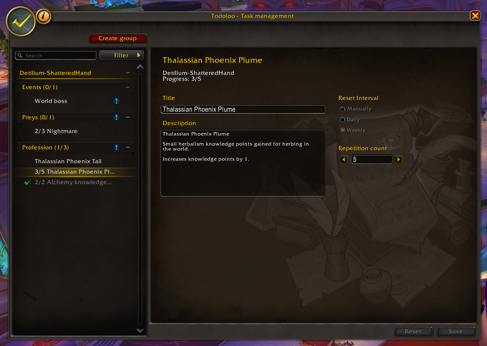
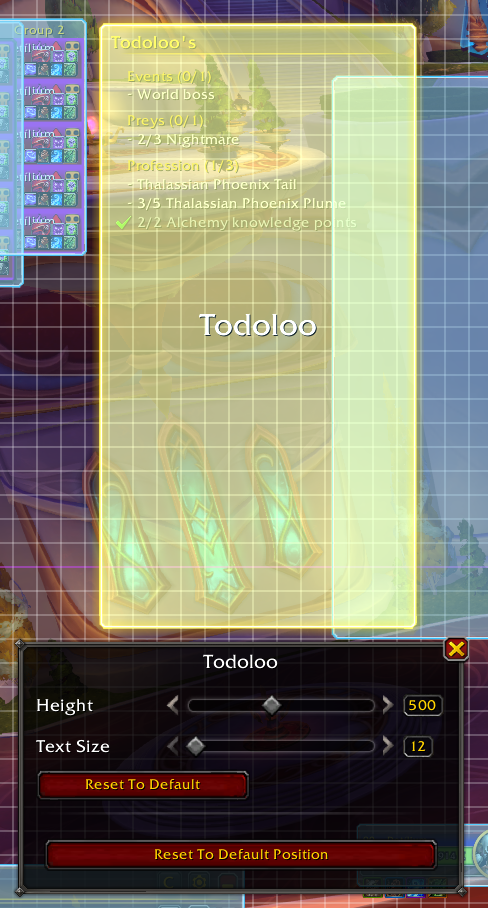

# Todoloo
Todoloo is your friendly in-game task management assistant, helping you remember mount runs, transmog runs, profession tasks, and more. This addon is developed with the philosophy that it should feel like part of World of Warcraft, with a familiar look and controls that feel natural to use.

## ✨ Key features
* Create tasks for individual characters, with daily, weekly, or manual resets
* Organize tasks into custom groups
* Set repetition counts for tasks that require multiple steps, displayed as progress such as `5/10 Kill wolves`
* Add custom task descriptions and review them by hovering over tasks in either tracker
* Edit task titles, descriptions, reset intervals, and repetition counts in a dedicated details pane
* Track tasks in a Blizzard-style floating tracker or alongside the objective tracker
* Hide completed tasks and groups, or move completed tasks to the bottom
* Manage tasks across your characters using filters and search

## ❓ Getting started
### Task Tracker
* `Shift` + `Left-Click` a task to complete it or add one repetition
* `Ctrl` + `Left-Click` a task to undo completion or subtract one repetition
* Hover over a task to read its custom description, if one has been added
* Choose between the floating tracker and the attached tracker in Todoloo settings
* Optionally hide the floating tracker during combat
* Choose whether completed tasks and groups remain visible in the settings

Open Todoloo settings: `Right-Click` the minimap icon or use `/tdl settings`.

#### Customizing the floating tracker
Open World of Warcraft's **Edit Mode**, then select the floating tracker to reposition it or adjust its **Height** and **Text Size**. Use Edit Mode's save and revert controls to keep or discard your changes.

These settings are saved separately for each character and Edit Mode layout. The floating tracker can only be moved while Edit Mode is active.

When tasks exceed the available space, the tracker displays **Additional tasks hidden** beneath a separator. Increase its height or reduce its text size to display more tasks.

### Task Manager
`Left-Click` the minimap icon or use `/tdl tm` to open the task manager.

* Use the **Filter** button to choose which characters appear
* Search for tasks and groups by name
* Click the info icon to open the in-game help guide

#### Characters
* `Left-Click` a character header to collapse or expand its groups and tasks
* `Right-Click` a character header to add a group

#### Groups
* Use **Create group** to add a group for your current character
* `Double-Click` a group to rename it
* `Shift` + `Left-Click` a group to collapse or expand it
* Drag and drop groups to change their order within the same character
* `Right-Click` a group to change its reset interval, add a task, or delete it

When a group defines a reset interval, its tasks inherit that interval. Set the group's reset interval to **None** to configure resets separately for each task.

#### Tasks
* `Left-Click` a task to open its details editor
* Edit its title, optional description, reset interval, and repetition count
* Click **Save** to apply your edits
* Click **Reset** to discard your edits and restore the task's saved settings
* Selecting another task with unsaved edits prompts you before discarding them
* Drag and drop tasks to reorder them or move them between groups belonging to the same character
* `Shift` + `Left-Click` a task to complete it or add one repetition
* `Ctrl` + `Left-Click` a task to undo completion or subtract one repetition
* `Right-Click` a task to delete it

A repetition count of `1` behaves as a regular checkbox task. Higher counts display progress until the target is reached (_for example, `5/10 Kill wolves`_).

## 📧 Commands
Commands start with `/tdl` or `/todoloo`. The following commands are available:
* `tm`, `task-manager`: Open the task manager
* `tt`, `task-tracker`: Toggle the floating task tracker
* `s`, `settings`: Open Todoloo settings

## 📣 Feedback
### Bug
Report bugs on the [GitHub issues page](https://github.com/Todoloo-WoW/Todoloo/issues).

### Feature requests
Suggest features on the [GitHub issues page](https://github.com/Todoloo-WoW/Todoloo/issues).